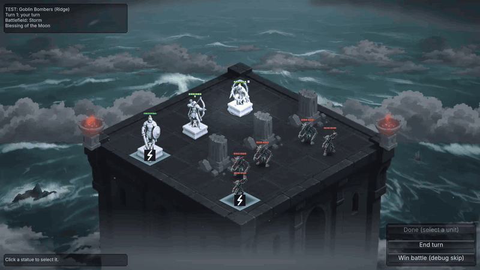
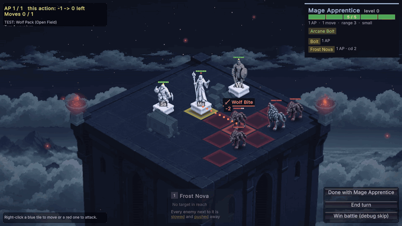
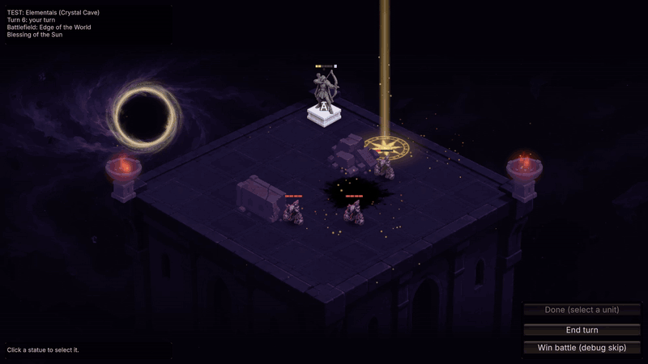
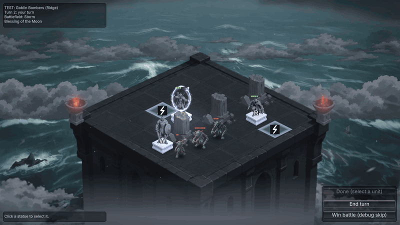

# ArmyRoguelike *(working title, in development)*

A single-player roguelike army-builder made in Unity. You lead a small squad of living statues across a branching map. Each fight is a turn-based tactical battle against an AI army on a small isometric grid.

| A turn against goblins in the Storm: shield bash, pinning shot, vanish | The wolf pack howls for an extra move and rushes in |
|---|---|
|  |  |
| **Sun beam against elementals at the Edge of the World** | **Moon shield, lightning and victory in the Storm** |
|  |  |

## Design docs

Open in the browser at **[nairigy.github.io/ArmyRoguelike](https://nairigy.github.io/ArmyRoguelike/)**:

- [Gamepedia](https://nairigy.github.io/ArmyRoguelike/gamepedia.html): every unit, ability, item, enemy and rule with its numbers, generated from the game data.
- [Hero synergy map](https://nairigy.github.io/ArmyRoguelike/synergy-map.html): every hero skill, item and rule tagged by theme, with its role in a build and a judgment.
- [Enemy faction map](https://nairigy.github.io/ArmyRoguelike/faction-map.html): each faction's plan, unit roles, combos and the hero themes that answer it.
- [Design note](docs/design-note.md): what has been decided and why. [Design history](docs/design-history.md): replaced rules and why.

## Tech

Unity 6 (6000.3), C#, URP 2D, Input System. Windows desktop.

## How it was made

Solo project. Design, systems and balance are mine. The code was written with help from AI (Claude), and the art and some sounds are AI-generated. Sound credits: [Assets/Audio/CREDITS.md](Assets/Audio/CREDITS.md).
